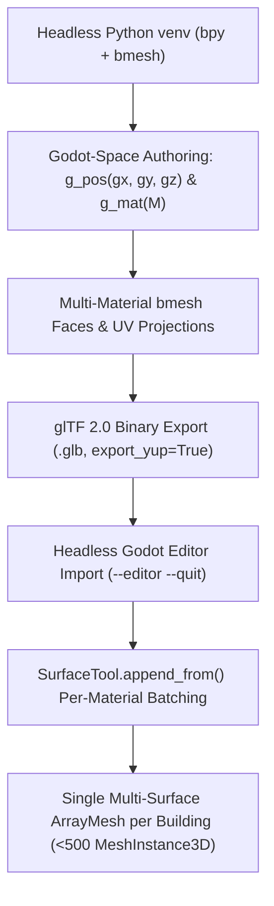

# Blender-to-Godot 4 Modular 3D Pipeline (`bpy` + `bmesh` $\rightarrow$ WebGL 2.0)

Use this skill when generating 3D modular architecture, props, foliage, or equipment in headless **Blender (`bpy` + `bmesh`)** and assembling them procedurally in **Godot 4.x (GL Compatibility / WebGL 2.0)** without violating draw-call or `MeshInstance3D` node budgets.

---

## Architecture Overview



---

## 1. Provisioning Headless Blender (`bpy`) in User Space

When running in a container or sandbox without system-wide `blender` installed, install `bpy` into an isolated `uv` virtual environment in `/tmp`:

```bash
uv venv /tmp/bvenv
uv pip install --python /tmp/bvenv/bin/python bpy trimesh pillow numpy
/tmp/bvenv/bin/python scripts/architecture/generate_laftehytte_modules_blender.py
```

> [!TIP]
> Never create the Python virtualenv inside the Godot project root without adding it to `.gdignore` and `export_presets.cfg` (`exclude_filter`), or Godot will scan thousands of site-packages files during `--editor --quit`. Placing the venv in `/tmp/bvenv` avoids any project pollution.

---

## 2. Exact Coordinate & Basis Mapping (Blender Z-Up $\leftrightarrow$ Godot Y-Up)

Blender uses a right-handed **Z-up** coordinate system (`+X` right, `+Y` back, `+Z` up). Godot 4 and glTF 2.0 use a right-handed **Y-up** coordinate system (`+X` right, `+Y` up, `+Z` south/back). When exporting with `bpy.ops.export_scene.gltf(..., export_yup=True)`, Blender maps $(x_b, y_b, z_b) \mapsto (x_b, z_b, -y_b)$.

To author geometry directly in **Godot local coordinates** `(gx, gy, gz)` with zero orientation mismatch or root-node rotation workarounds, apply the inverse orthogonal change-of-basis matrix $C$:

$$C = \begin{bmatrix} 1 & 0 & 0 \\ 0 & 0 & -1 \\ 0 & 1 & 0 \end{bmatrix}, \quad C^{-1} = C^T = \begin{bmatrix} 1 & 0 & 0 \\ 0 & 0 & 1 \\ 0 & -1 & 0 \end{bmatrix}$$

### Drop-In Python Helpers for `bmesh`

```python
import math
from mathutils import Vector, Matrix

C_G2B = Matrix((
    (1.0, 0.0,  0.0),
    (0.0, 0.0, -1.0),
    (0.0, 1.0,  0.0),
))
C_B2G = C_G2B.transposed()

def g_pos(gx: float, gy: float, gz: float) -> Vector:
    """Convert Godot (X right, Y up, Z south) to Blender (X right, Y north, Z up)."""
    return Vector((gx, -gz, gy))

def g_mat(m_godot_3x3: Matrix) -> Matrix:
    """Convert a 3x3 rotation/scale Matrix defined in Godot axes into Blender axes."""
    return C_G2B @ m_godot_3x3 @ C_B2G

def g_rot_x(angle_rad: float) -> Matrix:
    return g_mat(Matrix.Rotation(angle_rad, 3, 'X'))

def g_rot_y(angle_rad: float) -> Matrix:
    return g_mat(Matrix.Rotation(angle_rad, 3, 'Y'))

def g_rot_z(angle_rad: float) -> Matrix:
    return g_mat(Matrix.Rotation(angle_rad, 3, 'Z'))
```

---

## 3. Multi-Material `bmesh` Authoring & glTF Surface Preservation

When a single Blender `Mesh` contains faces assigned to multiple `bpy.data.materials` slots (`face.material_index = mat_idx`), Blender's glTF 2.0 exporter automatically splits the mesh into one glTF primitive (one Godot `ArrayMesh` surface) per used material and preserves the exact Blender material name on `mesh.surface_get_material(s).resource_name`.

### Blender Export Routine

```python
def finalize_and_export_glb(bm: bmesh.types.BMesh, name: str, out_dir: str, mat_list: list):
    bmesh.ops.recalc_face_normals(bm, faces=bm.faces)
    mesh = bpy.data.meshes.new(name)
    bm.to_mesh(mesh)
    bm.free()

    for mat in mat_list:
        mesh.materials.append(mat)

    # Smooth-shade organic surfaces or keep flat-shaded architectural facets
    for poly in mesh.polygons:
        poly.use_smooth = False

    bpy.ops.object.select_all(action='DESELECT')
    for obj in list(bpy.data.objects):
        bpy.data.objects.remove(obj, do_unlink=True)

    obj = bpy.data.objects.new(name, mesh)
    bpy.context.collection.objects.link(obj)
    bpy.context.view_layer.objects.active = obj
    obj.select_set(True)

    filepath = os.path.join(out_dir, f"{name}.glb")
    bpy.ops.export_scene.gltf(
        filepath=filepath,
        export_format='GLB',
        use_selection=True,
        export_yup=True,
        export_apply=True,
        export_materials='EXPORT',
        export_normals=True,
        export_texcoords=True,
    )
```

---

## 4. Extracting & Batching `.glb` Modules in Godot 4 (`SurfaceTool.append_from`)

> [!IMPORTANT]
> In Godot 4's `gl_compatibility` (WebGL 2.0) renderer, instancing buildings out of 25–35 separate child `MeshInstance3D` nodes per building rapidly exceeds the `< 500 MeshInstance3D` WebGL draw-call budget. Always stamp modular `.glb` surfaces into per-material `SurfaceTool` streams and commit a **single multi-surface `ArrayMesh` per building**.

### Extracting & Caching `ArrayMesh` from Imported `.glb` `PackedScene`

```gdscript
var _module_meshes: Dictionary = {} # module_id -> ArrayMesh

func get_module_mesh(module_id: String, path: String) -> ArrayMesh:
    if _module_meshes.has(module_id):
        return _module_meshes[module_id]
    if not ResourceLoader.exists(path):
        return null
    var res := load(path)
    var found_mesh: ArrayMesh = null
    if res is PackedScene:
        var inst := (res as PackedScene).instantiate()
        found_mesh = _find_first_array_mesh(inst)
        inst.free()
    elif res is ArrayMesh:
        found_mesh = res
    if found_mesh != null:
        _module_meshes[module_id] = found_mesh
    return found_mesh
```

### Stamping Scaled/Rotated Modules into `SurfaceTool`

```gdscript
func _append_blender_module(
    st_by_mat: Dictionary,
    module_id: String,
    xform: Transform3D,
    override_mat: Material = null
) -> bool:
    var mesh := get_module_mesh(module_id, MODULE_PATHS[module_id])
    if mesh == null or mesh.get_surface_count() == 0:
        return false
    for s in range(mesh.get_surface_count()):
        var mat := _resolve_blender_surface_material(mesh, s, override_mat)
        if not st_by_mat.has(mat):
            var new_st := SurfaceTool.new()
            new_st.begin(Mesh.PRIMITIVE_TRIANGLES)
            new_st.set_material(mat)
            st_by_mat[mat] = new_st
        var st: SurfaceTool = st_by_mat[mat]
        st.append_from(mesh, s, xform)
    return true

func _commit_mat_sts(st_by_mat: Dictionary) -> ArrayMesh:
    var out_mesh := ArrayMesh.new()
    for mat in st_by_mat.keys():
        var st: SurfaceTool = st_by_mat[mat]
        st.generate_normals()
        st.generate_tangents()
        st.commit(out_mesh)
    return out_mesh
```

---

## 5. Headless Godot Import & Web Export Checklist

1. **Guard Raw Third-Party Model Directories (`3dmodels/.gdignore`):**
   Before running `godot --headless --editor --quit` to import new `.glb` modules in `assets/modular_pieces/`, ensure raw reference folders (like `3dmodels/`) contain a `.gdignore` during the import pass if you do not want Godot to extract embedded `.jpg`/`.png` textures into the working tree.
2. **Import `.glb` Modules via Headless Editor:**
   ```bash
   xvfb-run -a /tmp/godot --headless --path . --editor --quit
   ```
   Verify that every `.glb` file has a corresponding `.glb.import` sidecar file committed to git.
3. **Verify Scene Node Budget & Visual Render:**
   Run an offscreen OpenGL3 verification script under `xvfb-run -a /tmp/godot --rendering-driver opengl3` to assert:
   - All `.glb` modules load with `surface_count > 0`.
   - Total active scene `MeshInstance3D` count remains strictly `< 500`.
4. **Export `index.pck` & Synchronize HTML Byte Sizes:**
   ```bash
   xvfb-run -a /tmp/godot --headless --export-pack "Web" web/public/index.pck
   stat -c%s web/public/index.pck
   ```
   Update `GODOT_CONFIG.fileSizes["index.pck"]` in both `web/index.html` and `web/public/index.html`.
