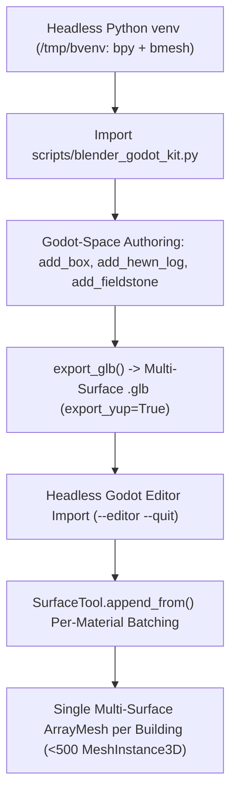

# Blender-to-Godot 4 Modular 3D Pipeline (`bpy` + `bmesh` $\rightarrow$ WebGL 2.0)

Use this skill when generating 3D modular architecture, props, foliage, or equipment in headless **Blender (`bpy` + `bmesh`)**, decimating high-poly raw `.glb` models, and assembling them procedurally in **Godot 4.x (GL Compatibility / WebGL 2.0)** without violating draw-call or `MeshInstance3D` node budgets.

---

## Architecture Overview



---

## 1. Provisioning Headless Blender (`bpy`) in User Space

When running in a container or sandbox without system-wide `blender` installed, install `bpy` into an isolated `uv` virtual environment in `/tmp/bvenv`:

```bash
uv venv /tmp/bvenv
uv pip install --python /tmp/bvenv/bin/python bpy trimesh pillow numpy
```

> [!TIP]
> Never create the Python virtualenv inside the Godot project root without adding it to `.gdignore` and `export_presets.cfg` (`exclude_filter`), or Godot will scan thousands of site-packages files during `--editor --quit`. Placing the venv in `/tmp/bvenv` avoids any project pollution.

---

## 2. Using the Bundled `blender_godot_kit.py` Helper Library

This skill bundles [`scripts/blender_godot_kit.py`](scripts/blender_godot_kit.py), which handles all Blender Z-up $\leftrightarrow$ Godot Y-up coordinate math, material slot binding, procedural `bmesh` primitives, triplanar box UV projection, and `.glb` exporting.

### Quick-Start Example (Creating a New Modular Asset)

```python
import os
import sys

sys.path.append(os.path.abspath(".agents/skills/blender-godot-modular-pipeline/scripts"))
import blender_godot_kit as bgk

# 1. Reset headless Blender scene & create the 9-material Medieval Bergen palette
bgk.reset_scene()
palette = bgk.MaterialPalette.create_medieval_bergen_palette()
bm = bgk.new_bmesh()

# 2. Build geometry directly in Godot coordinates (X right, Y up, Z south)
# Stone base pier
bgk.add_fieldstone(bm, center_g=(0.0, 0.20, 0.0), radii_g=(0.35, 0.22, 0.35), mat_idx=palette.idx("stone_foundation"), seed=1)
# Vertical hand-hewn stave post
bgk.add_hewn_log(bm, start_g=(0.0, 0.38, 0.0), end_g=(0.0, 2.80, 0.0), radius=0.14, mat_idx=palette.idx("wood_spruce"))
# Angled wind brace rotated 45 degrees around Godot Z axis
bgk.add_box(bm, center_g=(0.45, 2.25, 0.0), size_g=(1.10, 0.14, 0.14), mat_idx=palette.idx("wood_dark"), rot_g=bgk.g_rot_z(0.7854))

# 3. Export binary .glb with automatic normals, triplanar box UVs, and material slots
bgk.export_glb(bm, name="grindverk_stave_post", out_dir="assets/modular_pieces/grindverk", palette=palette)
```

### Available Primitives & Helpers in `blender_godot_kit.py`
| Function / Class | Description |
| :--- | :--- |
| `g_pos(gx, gy, gz)` / `g_vec(v)` | Converts Godot `(X right, Y up, Z south)` coordinates to Blender `(X, -Z, Y)` |
| `g_mat(m_3x3)` / `g_rot_x/y/z(rad)` / `g_euler(...)` | Converts a 3x3 rotation/scale matrix defined in Godot axes into Blender axes via $C \cdot M_{\text{godot}} \cdot C^{-1}$ |
| `MaterialPalette.create_medieval_bergen_palette()` | Creates the 9 named materials (`wood_spruce`, `wood_dark`, `wood_weathered`, `stone_foundation`, `sod_roof`, `birch_bark`, `iron_hardware`, `window_glass`, `shutter_wood`) |
| `add_box(bm, center_g, size_g, mat_idx, rot_g, bevel_top)` | Adds an oriented box in Godot space with optional top bevel |
| `add_hewn_log(bm, start_g, end_g, radius, mat_idx, ...)` | Adds an 8-sided broadaxe-flattened log between any two Godot 3D points with organic wobble and tapered *laftehode* ends |
| `add_cylinder_g(bm, base_center_g, axis_dir_g, length, ...)` | Adds an oriented cylinder or tapered frustum along any Godot direction vector |
| `add_fieldstone(bm, center_g, radii_g, mat_idx, seed)` | Adds a faceted gneiss/slate fieldstone block with flat bedding planes |
| `export_glb(bm, name, out_dir, palette, ...)` | Welds vertices, recalculates outward normals, projects triplanar UVs, binds materials, and exports `out_dir/name.glb` |
| `decimate_and_export_glb(in_path, out_path, target_tris)` | Imports a high-poly `.glb`, aligns `y_min = 0.0`, applies Collapse Decimation to `target_tris`, and exports a WebGL-ready `.glb` |

---

## 3. Coordinate Math Reference (Blender Z-Up $\leftrightarrow$ Godot Y-Up)

When exporting with `bpy.ops.export_scene.gltf(..., export_yup=True)`, Blender maps $(x_b, y_b, z_b) \mapsto (x_b, z_b, -y_b)$. The inverse orthogonal basis matrix $C$ used by `blender_godot_kit.py` is:

$$C = \begin{bmatrix} 1 & 0 & 0 \\ 0 & 0 & -1 \\ 0 & 1 & 0 \end{bmatrix}, \quad C^{-1} = C^T = \begin{bmatrix} 1 & 0 & 0 \\ 0 & 0 & 1 \\ 0 & -1 & 0 \end{bmatrix}, \quad M_{\text{blender}} = C \cdot M_{\text{godot}} \cdot C^{-1}$$

---

## 4. Extracting & Batching `.glb` Modules in Godot 4 (`SurfaceTool.append_from`)

> [!IMPORTANT]
> In Godot 4's `gl_compatibility` (WebGL 2.0) renderer, instancing buildings out of 25–35 separate child `MeshInstance3D` nodes per building rapidly exceeds the `< 500 MeshInstance3D` WebGL draw-call budget. Always stamp modular `.glb` surfaces into per-material `SurfaceTool` streams and commit a **single multi-surface `ArrayMesh` per building**.

### Extracting & Caching `ArrayMesh` from Imported `.glb` `PackedScene`

```gdscript
var _module_meshes: Dictionary = {} # module_id -> ArrayMesh

func get_module_mesh(module_id: String, path: String) -> ArrayMesh:
    if _module_meshes.has(module_id):
        return _module_meshes[module_id]
    if not ResourceLoader.exists(path):
        return null
    var res := load(path)
    var found_mesh: ArrayMesh = null
    if res is PackedScene:
        var inst := (res as PackedScene).instantiate()
        found_mesh = _find_first_array_mesh(inst)
        inst.free()
    elif res is ArrayMesh:
        found_mesh = res
    if found_mesh != null:
        _module_meshes[module_id] = found_mesh
    return found_mesh
```

### Stamping Scaled/Rotated Modules into `SurfaceTool`

```gdscript
func _append_blender_module(
    st_by_mat: Dictionary,
    module_id: String,
    xform: Transform3D,
    override_mat: Material = null
) -> bool:
    var mesh := get_module_mesh(module_id, MODULE_PATHS[module_id])
    if mesh == null or mesh.get_surface_count() == 0:
        return false
    for s in range(mesh.get_surface_count()):
        var mat := _resolve_blender_surface_material(mesh, s, override_mat)
        if not st_by_mat.has(mat):
            var new_st := SurfaceTool.new()
            new_st.begin(Mesh.PRIMITIVE_TRIANGLES)
            new_st.set_material(mat)
            st_by_mat[mat] = new_st
        var st: SurfaceTool = st_by_mat[mat]
        st.append_from(mesh, s, xform)
    return true

func _commit_mat_sts(st_by_mat: Dictionary) -> ArrayMesh:
    var out_mesh := ArrayMesh.new()
    for mat in st_by_mat.keys():
        var st: SurfaceTool = st_by_mat[mat]
        st.generate_normals()
        st.generate_tangents()
        st.commit(out_mesh)
    return out_mesh
```

---

## 5. Headless Godot Import & Web Export Checklist

1. **Guard Raw Third-Party Model Directories (`3dmodels/.gdignore`):**
   Keep `3dmodels/.gdignore` present so `godot --headless --editor --quit` only imports optimized game assets in `assets/` and does not extract multi-megabyte textures from raw reference models in `3dmodels/`.
2. **Import `.glb` Modules via Headless Editor:**
   ```bash
   xvfb-run -a /tmp/godot --headless --path . --editor --quit
   ```
   Verify that every `.glb` file has a corresponding `.glb.import` sidecar file committed to git.
3. **Verify Scene Node Budget & Visual Render:**
   Run an offscreen OpenGL3 verification script under `xvfb-run -a /tmp/godot --rendering-driver opengl3` to assert:
   - All `.glb` modules load with `surface_count > 0`.
   - Total active scene `MeshInstance3D` count remains strictly `< 500`.
4. **Export `index.pck` & Synchronize HTML Byte Sizes:**
   ```bash
   xvfb-run -a /tmp/godot --headless --export-pack "Web" web/public/index.pck
   stat -c%s web/public/index.pck
   ```
   Update `GODOT_CONFIG.fileSizes["index.pck"]` in both `web/index.html` and `web/public/index.html`.
