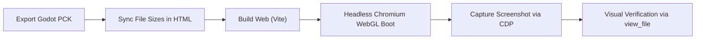

# Game Verification Skill

Use this skill whenever changes are made to scenes, shaders, scripts, terrain, or UI in the project, to verify that the web build functions correctly, renders properly, and contains no fatal runtime or visual regression.

---

## Verification Pipeline



---

## Step-by-Step Instructions

### Step 1: Export Godot Web Pack & Update File Sizes

1. Export the latest project pack using headless Godot:
   ```bash
   /home/antigravity/bin/godot --headless --export-pack "Web" web/public/index.pck
   ```
2. Check the exact byte size of `web/public/index.pck`:
   ```bash
   ls -l web/public/index.pck
   ```
3. Update `fileSizes` in both `web/index.html` and `web/public/index.html` to match the exact byte size of `index.pck`:
   ```json
   "fileSizes": { "index.pck": <EXACT_BYTES>, "index.wasm": 35376909 }
   ```
4. Build the web distribution:
   ```bash
   cd web && npm run build
   ```

---

### Step 2: Headless WebGL Inspection & Capture

Run the bundled CDP verification script:
```bash
node .agents/skills/game-verification/scripts/verify_game.js
```

This script:
- Connects to headless Chromium on `127.0.0.1:9222`
- Reloads the game page on `http://127.0.0.1:8080/`
- Monitors console exceptions and WebGL context loss
- Waits for engine and terrain generation to complete (10s)
- Captures a high-resolution screenshot to `/tmp/gameplay_verification.png`

---

### Step 3: Visual Inspection via `view_file`

Inspect the captured screenshot using `view_file`:
```json
{
  "AbsolutePath": "/tmp/gameplay_verification.png"
}
```

Check the 5 visual pillars:
1. **3D Terrain**: Green meadows, mountain crags (Fløyen), and shorelines render visibly without blanking.
2. **Fjord Water**: Vågen bay renders with transparency and specular light reflection.
3. **Settler Character**: Third-person 3D character (box-man, animated limbs, leather backpack) is present.
4. **Environment & Structures**: Trees, log cabins, fences, and props are placed and visible.
5. **2D HUD / CanvasLayer**: Calendar clock, quest log, hotbar slots, and resource counts are cleanly drawn over the 3D scene.

---

### Step 4: Verification Reporting

Report verification results with:
- **Build Status**: Exit code of export and npm build.
- **Pack Size**: `index.pck` byte size.
- **Runtime Errors**: Any errors caught during boot or steady state.
- **Visual Assessment**: Key visible elements confirmed from screenshot inspection.
