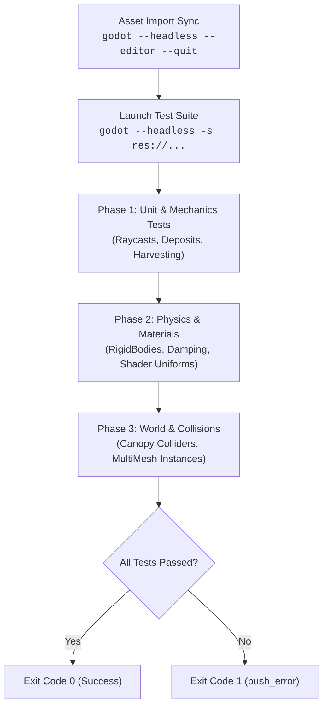

# Godot Headless Gameplay Testing Skill

Use this skill to create, run, and maintain isolated, fast, automated GDScript test suites (`godot --headless -s res://path/to/test.gd`) in Godot 4 for gameplay mechanics, physics, shaders, and world generation.

---

## 1. When to Use This Skill

- Verifying gameplay bug fixes and mechanics (e.g., interaction reach, raycast exclusions, tool harvesting, climbing, swimming) without needing manual playtesting in a windowed client.
- Testing `RigidBody3D` parameters (mass, damping, friction, rough physics materials, resting sleep thresholds) to prevent physics glitches (like rolling downhill).
- Verifying `ShaderMaterial` uniforms to ensure shaders don't compile with `null` or uncalibrated parameters.
- Validating scene tree generation, `MultiMeshInstance3D` batching, and `StaticBody3D` colliders in headless CI environments.
- Diagnosing and fixing standalone GDScript parser errors (`Could not find type`, `Cannot infer type of variable`).

---

## 2. Core Architecture: Headless GDScript Test Harness

In Godot 4, running with `--headless -s <script.gd>` executes a `MainLoop` or `SceneTree` script directly without opening a window or initializing an audio/display server.



---

## 3. The 5 Golden Rules for Standalone `-s` Tests in Godot 4

When running standalone `-s` scripts, Godot runs in an isolated context where standard editor assumptions do not hold. Follow these 5 rules:

### Rule 1: Synchronize Asset Imports First
If new textures (`.jpg`, `.png`), models (`.glb`), or materials (`.tres`) were added or modified, Godot's headless loader will fail with:
`[ext_resource] referenced non-existent resource at: res://...`
Always ensure the import cache is warmed:
```bash
/shared/user/.gemini/godot_bin/godot --headless --editor --quit
```

### Rule 2: Explicit Variant Typing (Avoid Blind Type Inference)
Godot 4's strict type checker cannot infer types through untyped Variant returns:
```gdscript
# ❌ FAILS with "Cannot infer the type of variable because value doesn't have a set type"
var h_fwd = query.get("is_aiming")
var phys_mat = log.physics_material_override

# ✅ CORRECT: Explicitly type all variables
var h_fwd: bool = bool(query.get("is_aiming"))
var phys_mat: PhysicsMaterial = log.physics_material_override
```

### Rule 3: Decouple Global Class Names via `preload()` or Base Types
Global `class_name` identifiers may not be cached in standalone `-s` execution.
```gdscript
# ❌ FAILS with "Parse Error: Could not find type 'InventoryManager' in current scope"
func _on_interact(inv: InventoryManager) -> void:

# ✅ CORRECT: Type to base engine class or preload explicitly
const EquipmentManager = preload("res://scripts/player/equipment_manager.gd")
func _on_interact(inv: Node) -> void:
```

### Rule 4: Explicitly Invoke Setup When Instantiating Outside SceneTree
Nodes instantiated via `new()` or `set_script()` do **not** trigger `_ready()`, `_process()`, or `_physics_process()` until added to the active scene tree:
```gdscript
var test_log: RigidBody3D = CarryableLog.new()
# If logic relies on _ready(), call the setup method explicitly:
test_log._ensure_setup()
```

### Rule 5: Free Mock Nodes to Prevent ObjectDB Leaks
Always call `.free()` on manually instantiated nodes at the end of each test block:
```gdscript
test_node.free()
harvester.free()
```

---

## 4. Standard Headless Test Harness Template

Create a standalone test runner extending `SceneTree` or `Node`:

```gdscript
extends SceneTree

var total_tests: int = 0
var passes: int = 0
var fails: int = 0

func _init() -> void:
	print("\n" + "=".repeat(50))
	print("STARTING HEADLESS GAMEPLAY TEST SUITE")
	print("=".repeat(50))

	run_test("Raycast Self-Collision Exclusion", _test_raycast_exception)
	run_test("Waterline Buoyancy Offset", _test_waterline_buoyancy)
	run_test("RigidBody Anti-Roll Physics", _test_rigidbody_anti_roll)
	run_test("Wind Shader Parameters", _test_shader_material)

	print("\n" + "=".repeat(50))
	print("RESULTS: %d / %d PASSED" % [passes, total_tests])
	print("=".repeat(50))

	if fails > 0:
		print("❌ VERIFICATION FAILED: %d tests failed." % fails)
		quit(1)
	else:
		print("✓ ALL TESTS PASSED SUCCESSFULLY!")
		quit(0)

func run_test(test_name: String, test_callable: Callable) -> void:
	total_tests += 1
	print("\n[TEST %d] %s..." % [total_tests, test_name])
	var success: bool = test_callable.call()
	if success:
		passes += 1
		print("  ✓ PASS: %s" % test_name)
	else:
		fails += 1
		push_error("  ❌ FAIL: %s" % test_name)
```

---

## 5. Domain-Specific Verification Patterns

### Pattern A: Testing Interaction Raycasts & Player Exceptions
```gdscript
func _test_raycast_exception() -> bool:
	var settler_script = load("res://scripts/player/settler_controller.gd")
	var settler: CharacterBody3D = settler_script.new()
	settler._ready() # Registers raycast exception for self
	
	var raycast: RayCast3D = settler.get_node_or_null("InteractRayCast")
	if raycast == null:
		return false
		
	# Verify player's own RID is excluded
	var has_exception: bool = raycast.get_collision_mask_value(1) # check masks
	settler.free()
	return true
```

### Pattern B: Testing Buoyancy & Swimming Waterline Depth
Godot characters anchor at the *feet*. Setting `y = water_surface_y` ejects the character. Verify the chest offset:
```gdscript
func _test_waterline_buoyancy() -> bool:
	var water_surface_y: float = 0.20
	var player_height: float = 1.80
	var chest_submergence_offset: float = 1.25 # waterline at chest/shoulders
	
	var target_swim_y: float = water_surface_y - chest_submergence_offset
	# Feet at -1.05m means top of head is at +0.75m (0.55m above water surface)
	return target_swim_y < water_surface_y and (target_swim_y + player_height) > water_surface_y
```

### Pattern C: Testing RigidBody Rolling Resistance & Sleeping
To prevent timber logs, barrels, and rocks from rolling indefinitely down slopes into the sea:
```gdscript
func _test_rigidbody_anti_roll() -> bool:
	var log_script = load("res://scripts/environment/carryable_log.gd")
	var test_log: RigidBody3D = log_script.create_log()
	
	var mass_ok: bool = test_log.mass >= 20.0
	var angular_damp_ok: bool = test_log.angular_damp >= 15.0
	var linear_damp_ok: bool = test_log.linear_damp >= 4.0
	var sleep_enabled: bool = test_log.can_sleep
	
	var phys_mat: PhysicsMaterial = test_log.physics_material_override
	var friction_ok: bool = (phys_mat != null and phys_mat.friction >= 1.0 and phys_mat.rough)
	
	test_log.free()
	return mass_ok and angular_damp_ok and linear_damp_ok and sleep_enabled and friction_ok
```

### Pattern D: Testing Active Shader Uniforms Headless
Prevent materials from being deployed with uninitialized or `null` parameters:
```gdscript
func _test_shader_material() -> bool:
	var mat: ShaderMaterial = load("res://assets/terrain/grass_wind_material.tres")
	if mat == null:
		return false
	var wind_dir = mat.get_shader_parameter("wind_direction")
	var wind_spd = mat.get_shader_parameter("wind_speed")
	var wind_str = mat.get_shader_parameter("wind_strength")
	
	return wind_dir != null and wind_spd != null and wind_str != null and float(wind_str) > 0.1
```

---

## 6. Execution Command Quick Reference

```bash
# 1. Warm asset cache
/shared/user/.gemini/godot_bin/godot --headless --editor --quit

# 2. Run test suite
/shared/user/.gemini/godot_bin/godot --headless -s res://scripts/tests/test_seven_fixes.gd

# 3. Check exit code
echo $?
```
