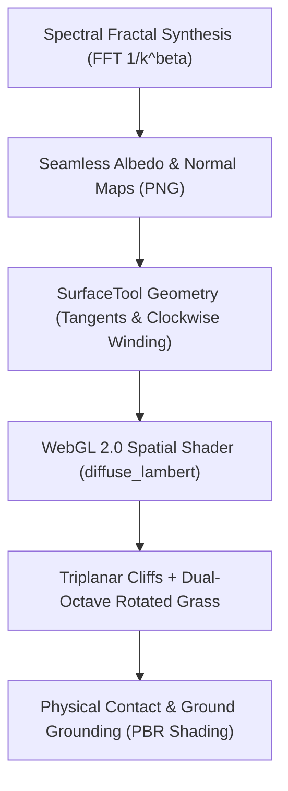

# Procedural Terrain PBR Pipeline

Use this skill when building or upgrading terrain in Godot 4 3D projects (especially WebGL / Compatibility targets) to ensure players experience rich, physical ground texturing with authentic lighting and normal map depth, avoiding the flat "unshaded green void" pitfall.

---

## Architecture Overview



---

## 1. Seamless Spectral Fractal Texture Generation

Traditional sinusoidal grid noise produces unnatural diamond or grid repetition artifacts. In contrast, **2D Fourier spectral synthesis** applies a power-law filter $S(u, v) \propto (u^2 + v^2)^{-\beta / 2}$ to Fourier white noise. This produces mathematically isotropic fractional Brownian motion (fBm) with periodic toroidal boundary conditions, guaranteeing **100% seamless tiling**.

### Generating Textures
Run the bundled spectral generator script:
```bash
python3 .agents/skills/procedural-terrain-pbr-pipeline/scripts/generate_spectral_textures.py assets/terrain
```

### Parameter Guidelines
| Biome Layer | Filter Exponent $\beta$ | Visual Characteristic |
| :--- | :--- | :--- |
| **Macro Moisture** | $\beta = 2.3$ | Low-frequency bog moisture and regional moss patches across the map |
| **Turf Clumping** | $\beta = 1.8$ | Mid-scale turf mounds and sod elevation |
| **Grass Blades** | $\beta = 1.1$ | High-frequency individual grass blade strokes and tips |
| **Micro Loam/Soil** | $\beta = 0.8$ | Soil pebble grain, fine thatch, and humus depressions |
| **Rock Strata** | $\beta = 2.3$ | Geological metamorphic banding and slate cleavage lines |
| **Rock Crags & Fissures** | $\beta = 1.0$–$1.5$ | Sharp angular fractures and quartz veins |

### Seamless Tangent-Space Normal Maps
Use periodic Sobel central differences with coordinate rolling:
```python
dx = (np.roll(h, -1, axis=1) - np.roll(h, 1, axis=1)) * 0.5
dy = (np.roll(h, -1, axis=0) - np.roll(h, 1, axis=0)) * 0.5
```
Normal vectors are normalized and packed to RGB $[0, 255]$ with $+Z$ pointing directly upward along the surface normal.

---

## 2. SurfaceTool Geometry & Tangent Generation

For normal maps to illuminate correctly, meshes built via `SurfaceTool` must generate valid tangent vectors and follow clockwise front-face winding:

```gdscript
var st := SurfaceTool.new()
st.begin(Mesh.PRIMITIVE_TRIANGLES)

# Triangle 1 (v0 -> v1 -> v2) Front-facing Clockwise (looking from above)
# Triangle 2 (v1 -> v3 -> v2) Front-facing Clockwise

# CRUCIAL: Generate Tangents for PBR Normal Mapping
st.generate_tangents()
var mesh := st.commit()
```

---

## 3. WebGL 2.0 / Compatibility Renderer Shader Rules

In Godot 4 WebGL exports, adhere to these compatibility constraints:

1. **Diffuse Mode:**
   ```glsl
   shader_type spatial;
   render_mode cull_back, diffuse_lambert, specular_schlick_ggx;
   ```
   > [!WARNING]
   > Do NOT use `diffuse_burley` in Compatibility / WebGL 2.0 mode; it is exclusive to Mobile / Forward+ renderers and can cause shader fallback issues.

2. **Triplanar Rock Projection for Steep Cliffs:**
   Project rock textures along world $X, Y, Z$ planes on steep slopes ($> 40^\circ$) to eliminate vertical wall stretching:
   ```glsl
   vec3 tri_weights = pow(abs(v_world_normal), vec3(5.0));
   tri_weights /= max(tri_weights.x + tri_weights.y + tri_weights.z, 0.0001);
   ```

3. **Dual-Octave Rotated Grass Sampling:**
   Combine a primary scale with a secondary octave rotated by $45^\circ$ ($0.7071$) at $0.51\times$ scale to eliminate visible repeating patterns across valleys:
   ```glsl
   vec2 uv_grass1 = v_world_pos.xz * grass_uv_scale;
   vec2 uv_grass2 = vec2(
       v_world_pos.x * 0.7071 - v_world_pos.z * 0.7071,
       v_world_pos.x * 0.7071 + v_world_pos.z * 0.7071
   ) * (grass_uv_scale * 0.51) + vec2(19.4, 37.1);
   ```

4. **Never Fall Back to Unshaded:**
   Never set `shading_mode = BaseMaterial3D.SHADING_MODE_UNSHADED` on terrain meshes. It disables directional sun lighting, ambient occlusion, specular sheen, and contact shadows, creating a disconnected flat-color appearance.
