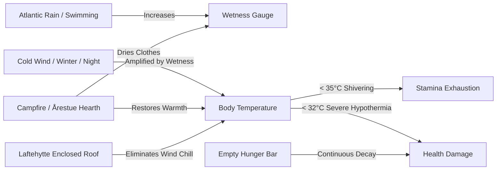
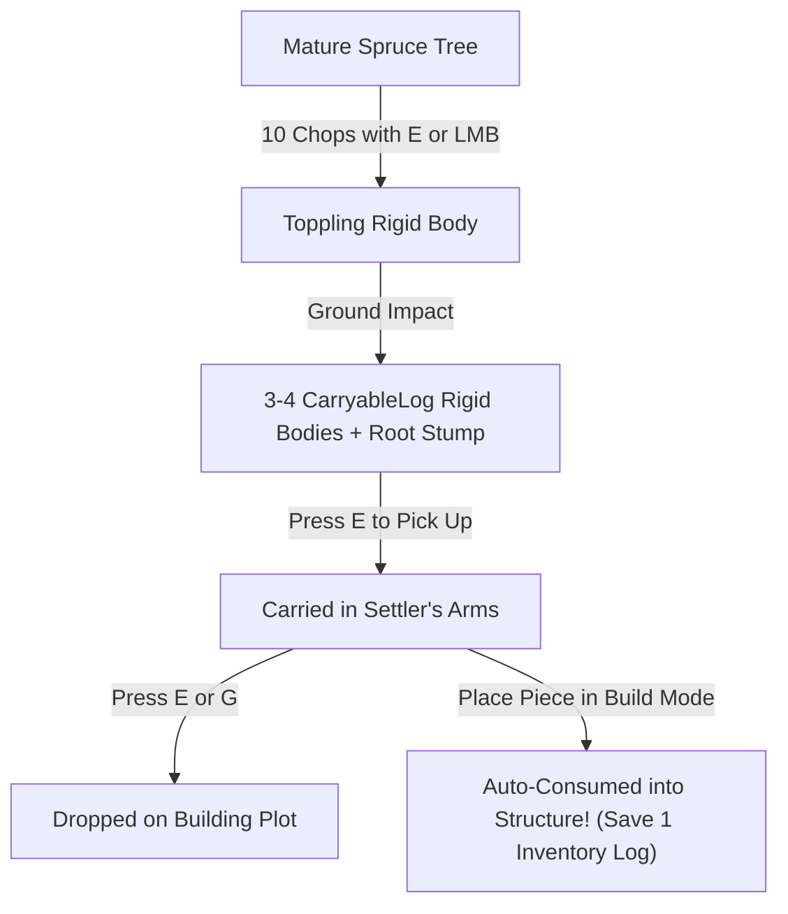
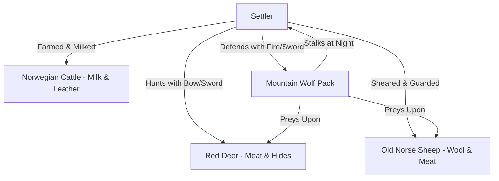

# Medieval Bergen 1360 — Official Settler's Handbook & Gameplay Guide

> *"The sea gave life, the forest gave shelter, the stone gave warmth, and the mountain demanded respect."*  
> — Western Norwegian Settler Maxim, c. 1360

Welcome ashore to the rugged fjord landscape of Bergen (*Bjørgvin*) in the year of our Lord **1360**. You arrive during a transformative era: King Magnus VII's *Landslov* governs the realm, German Hanseatic merchants dominate the bustling wharves of Bryggen, and the untamed wilderness of Mount Fløyen and Byfjorden challenges every settler to master the ancient arts of Norse survival and vernacular log architecture (*lafteverk*).

This handbook provides an exhaustive guide to survival systems, harvesting mechanics, vernacular construction, climbing, swimming, and thriving in 14th-century Norway.

---

## Table of Contents
1. [Controls & Interface Reference](#1-controls--interface-reference)
2. [The Five Vital Survival Gauges](#2-the-five-vital-survival-gauges)
3. [Mastering Forestry & Tree Felling](#3-mastering-forestry--tree-felling)
4. [Physical Log Hauling & Logistics](#4-physical-log-hauling--logistics)
5. [Mining Bog Iron Ore & Peat](#5-mining-bog-iron-ore--peat)
6. [Vernacular Laftehytte Construction](#6-vernacular-laftehytte-construction)
7. [Mountain Climbing & Rope Deployment](#7-mountain-climbing--rope-deployment)
8. [Fjord Navigation & Swimming](#8-fjord-navigation--swimming)
9. [Fauna, Predators & Hunting](#9-fauna-predators--hunting)
10. [The 1360 Calendar & Seasons](#10-the-1360-calendar--seasons)
11. [The Settler's First 24 Hours (Walkthrough)](#11-the-settlers-first-24-hours-walkthrough)

---

## 1. Controls & Interface Reference

### Keyboard & Mouse Controls

| Input | Action | Context & Behavior |
| :--- | :--- | :--- |
| **`W` `A` `S` `D`** | **Movement** | Walk forward, left, backward, and right across the terrain |
| **`Left Shift`** | **Sprint** | Run at increased speed; drains stamina over time |
| **`Space`** | **Jump / Vault** | Jump upward on land; surface toward the waterline in water |
| **`Left Mouse Button`** | **Primary Attack / Chop** | Swing axe or weapon; chop targeted trees; mine ore; place building pieces in Build Mode |
| **`E`** | **Interact / Action** | Chop trees; pick up logs; harvest bog ore; draw water from wells; talk to NPCs |
| **`B`** | **Toggle Build Mode** | Opens or closes the Laftehytte architectural building overlay and ghost preview |
| **`R`** | **Rotate Building Piece** | Rotates the selected building module by 90° increments |
| **`Q`** / **`Tab`** | **Cycle Recipes** | Cycle backward or forward through available architectural pieces and recipes |
| **`Left Click` (in Build Mode)** | **Place Piece** | Commit and build the currently previewed green architectural piece |
| **`F`** | **Toggle Head Torch** | Ignite or extinguish your pine pitch head torch for nocturnal illumination |
| **`H`** | **Eat Food** | Consume the best available food item from your inventory to restore hunger |
| **`V`** | **Toggle Camera Mode** | Switch between First-Person perspective and Third-Person cinematic view |
| **`T`** | **Deploy Rope** | Secure and deploy a hemp climbing rope down a cliff face when near an edge |
| **`1` `2` `3` `4` `5`** | **Hotbar Tool Slots** | Equip Axe (`1`), Sword (`2`), Torch (`3`), Pickaxe (`4`), or Hammer (`5`) |
| **`Mouse Move`** | **Look / Aim** | Rotate camera pitch and yaw; aims interaction crosshair and chopping focus |

---

### HUD Elements & Displays

1. **Top Center — Clock & Calendar Widget**:
   - **Year & Date**: Displays the authentic medieval calendar starting **March 1, 1360**.
   - **Time of Day**: Accurate 24-hour sun time calibrated to Bergen's northern latitude (**60.4° N**).
   - **Season Indicator**: Tracks the seasonal shift from Spring Thaw to Summer Green, Autumn Harvest, and Polar Winter.
2. **Bottom Center — Hotbar**:
   - Quick-access slots 1 through 5 displaying equipped tool durability, state, and active selection.
3. **Bottom Left — Vital Survival Bars**:
   - Red: **Health**
   - Amber: **Hunger**
   - Green: **Stamina**
   - Cyan/Orange: **Core Body Temperature**
   - Blue: **Clothing Wetness**
4. **Bottom Right (in Build Mode) — Architectural Selector**:
   - Displays the active recipe name, required resources (timber logs, stones, birch bark, turf), and inventory status.

---

## 2. The Five Vital Survival Gauges

Survival in medieval Norway requires constant attention to your physiological state. Neglecting cold, moisture, or hunger leads swiftly to hypothermia and death.



### 1. Health (Helse)
- **Base Maximum**: 100 points.
- Depleted by hypothermia, starvation, high falls from mountain cliffs, and wolf attacks.
- Only regenerates naturally when hunger is above 75%, core body temperature is normal (>36.5°C), and you are fully rested.

### 2. Hunger (Sult)
- Degrades continuously throughout the workday (accelerated by heavy sprinting and timber felling).
- When hunger reaches zero, you begin suffering starvation damage at a rate of 1 HP every 3 seconds.
- **Nourishment Sources**:
  - **Tørrfisk (Dried Atlantic Cod)**: The gold standard of Norse sustenance; highly shelf-stable and restores 35 hunger.
  - **Barley Bread (Byggbrød)**: Baked from farmstead grain; restores 25 hunger.
  - **Forest Berries (Tyttebær & Blåbær)**: Foraged in woodland glades; provides quick stamina and 8 hunger.
  - **Venison & Hare Stew**: Cooked over a stone campfire; restores 50 hunger and provides a temporary warmth buff.
- Press **`[H]`** at any time to consume food immediately from your pack.

### 3. Stamina (Utholdenhet)
- Consumed by sprinting (**`Shift`**), chopping trees (**`LMB`** or **`E`**), rock climbing, and sprint swimming.
- Exhaustion occurs when the bar empties: your settler will be unable to sprint or climb, and swimming speed drops drastically.
- Regenerates rapidly when standing still, walking, or resting on a wooden *langbenk* bench.

### 4. Core Body Temperature (Kroppstemperatur)
- Normal body temperature is **37.0°C**.
- The ambient air temperature in Bergen fluctuates dynamically depending on:
  - **Time of Day**: Warmest at 13:00; coldest at 04:00 before sunrise.
  - **Season**: Mild in summer (14°C–22°C); freezing in winter (-8°C to -2°C).
  - **Altitude**: Climbing Mount Fløyen drops the ambient temperature by ~1.0°C per 100m elevation.
  - **Weather**: Atlantic gales, cold sleet, and driving mountain blizzards drastically increase wind chill.
- **Hypothermia Stages**:
  - *Mild Hypothermia (35.0°C–36.0°C)*: Violent shivering; stamina consumption increased by 30%.
  - *Moderate Hypothermia (32.0°C–35.0°C)*: Movement speed slowed; blurred vision; stamina ceases to regenerate.
  - *Severe Hypothermia (<32.0°C)*: Continuous health loss until warmth is restored or death ensues.

### 5. Wetness (Fuktighet)
- Walking in coastal rainstorms gradually soaks clothing; plunging into Byfjorden causes instantaneous 100% saturation.
- Wet clothing **multiplies heat loss by up to 4.5×**.
- Wetness can only be removed by:
  - Standing within 3.5m of a lit **Campfire** or indoor **Åre Hearth**.
  - Remaining inside an enclosed **Laftehytte** out of the rain.

---

## 3. Mastering Forestry & Tree Felling

Timber is the foundation of medieval Norwegian existence. Forests in the region comprise slow-grown **Norwegian Spruce (*Gran*)**, **Mountain Birch (*Bjørk*)**, and coastal **Scots Pine (*Furu*)**.

```
          [ Chop 4 / 10 ]
       [ ■ ■ ■ ■ □ □ □ □ □ □ ]
                 |
      [3D Billboard Tracker]
          (Floats ~0.95m next to trunk)
                 |
                 v
            /=========\
           /  CANOPY   \
          /             \
         /===============\
                 ||
                 ||   <-- Floating 3D Tracker (Eye level 2.05m)
                 ||
                 ||   <-- Progressive Undercut Notch
                 ||
    =============||============= (Ground Level)
```

### The 10-Chop Progression System
Unlike primitive arcade games where trees simply vanish into inventory items, every tree in *Medieval Bergen 1360* is a fully simulated physical entity requiring **exactly 10 chops** to fell.

1. **Targeting & Focus**:
   - Approach any forest canopy tree or standalone spruce/birch.
   - When within 4.5 meters, your settler focuses on the tree.
   - The **In-World 3D Progress Tracker** smoothly appears, floating **0.95m beside the trunk** at an eye level of **2.05m**.
   - Built with unshaded, depth-untested billboard materials, the tracker faces your camera and is never obscured or clipped by the trunk geometry.
2. **Executing Chops with `[E]` or Left Mouse Button**:
   - Strike the trunk using either the interaction key (**`[E]`**) or primary attack (**`Left Mouse Button`**).
   - Both inputs work interchangeably and reliably whether you have an axe equipped or are using secondary tools.
   - Each chop consumes 6.0 stamina points and inflicts physical trunk vibration shock.
3. **The Progressive Visual Gauge**:
   - With every strike, the floating tracker updates dynamically:
     ```text
     🌲 Gran (Spruce)
     Chop 7 / 10
     [ ■ ■ ■ ■ ■ ■ ■ □ □ □ ]
     ```
   - The floating fill bar transitions from a warm golden amber to a vibrant emerald green as completion nears.
   - Concurrently, a physical wood notch (*hoggskår*) deepens into the timber trunk on the felling side.
4. **Directional Felling Physics**:
   - The tree dynamically calculates the settler's position relative to its center axis.
   - **The tree always topples away from the chopper**.
   - On the **10th chop**, the trunk snaps free from its stump, tilts under gravity, and crashes to the ground under full rigid-body simulation.
   - **Caution**: Standing beneath a toppling trunk causes fatal crush damage. Step backward or sideways immediately after the 10th chop.
5. **Impact & Yield**:
   - When the canopy strikes the ground, the foliage shatters and the trunk automatically divides into **3 to 4 physical Carryable Timber Logs** distributed along the fall trajectory.
   - A realistic cut stump remains rooted at the felling point.

---

## 4. Physical Log Hauling & Logistics

Logs in *Medieval Bergen 1360* are physical rigid bodies that interact naturally with slopes and gravity.



### Lifting & Carrying
- Walk up to any fallen log and press **`[E]`**.
- Your settler hoists the heavy timber horizontally in both arms.
- While carrying a log:
  - Sprinting speed is reduced by 25%.
  - Jumping height is reduced.
  - Swimming is disabled (heavy spruce logs will drag you to the seabed).
- Press **`[E]`** or **`[G]`** to gently set the log back down.

### Anti-Roll Physics
- Timber logs feature active rolling resistance and angular friction damping.
- Logs dropped on hillside slopes around Bergen orient naturally across the gradient rather than rolling endlessly into Byfjorden.

### The Master Builder's Carry Discount
> **Pro Tip**: If you enter **Build Mode (`[B]`)** while actively holding a physical log in your arms and place a structure, that carried log is **automatically consumed directly** into the construction, deducting 1 log from your inventory cost! This allows you to harvest and build directly without constantly opening your pack.

---

## 5. Mining Bog Iron Ore & Peat

Before deep underground shaft mining reached Norway, medieval Norse blacksmiths relied on **Bog Iron Ore (*Jernmalm*)** harvested from peat bogs.

```
       [ Bog Iron Ore Deposit ]
            . - ~ ~ - .
        . '   ______    ' .
      (     /  Peat \      )   <-- Deep marsh wetlands
     (     |  Iron   |      )  <-- Harvest with [E] or Pickaxe
      ' .   \ Ore   /   . '
          ' - . _ . - '
```

### Locating Deposits
- Bog ore forms in slow-moving, iron-rich marshlands and freshwater runoff streams at the foot of Mount Fløyen.
- Look for dark, rusty-orange tinted earth mounds with bubbling reddish water.

### Harvesting Ore & Fuel Peat
- Approach a `BogOreDeposit` and press **`[E]`** or swing your pickaxe with **`Left Mouse Button`**.
- Interaction detection features dynamic ray scaling up to **5.5 meters** in third-person view and proximity search, ensuring hits register even from steep angles.
- **Yields**:
  - **Bog Iron Ore (Råjern)**: Unrefined spongy iron nodules rich in limonite.
  - **Peat Fuel (Brenntorv)**: Cut combustible sod blocks used to fire hearths and bloomery smelting furnaces.

### Smelting at the Bloomery (*Jernvinne*)
- Bring 3 lumps of bog ore and 2 blocks of dried peat fuel to a historical bloomery furnace located at the valley farmsteads.
- Igniting the charge produces a spongy iron bloom (*lupp*), which can be forged into nails, axe heads, and iron tools.

---

## 6. Vernacular Laftehytte Construction

The crown jewel of medieval Norwegian vernacular architecture is the **Laftehytte** (corner-notched log cabin). These structures withstood centuries of sub-polar gales without a single iron nail or dab of mortar.

```
             /\                <-- Torvtak (Green Sod & Birch Bark Roof)
            /  \               <-- Mønsås (Heavy Ridge Beam)
           /____\              <-- Laftegavl (Triangular Log Gable)
          |  __  |             <-- Laftevegg (Interlocking Notched Logs)
          | |  | |             <-- Døråpning (Framed Door Opening)
         =========             <-- Syllstokk (Heavy Sill Log Floor)
        [Fieldstone]           <-- Grunnmur (Dry Fieldstone Foundation)
```

### Entering Build Mode
1. Press **`[B]`** to toggle **Build Mode**.
2. An architectural ghost preview appears in front of your settler:
   - **Emerald Green**: Valid placement (stable foundation, clear clearance, sufficient materials).
   - **Translucent Red**: Obstructed or floating placement.
3. Press **`[R]`** to rotate the structure in **90° increments**. Always face your doorway away from the prevailing mountain winds coming off Mount Fløyen.
4. Press **`[Q]`** or **`[Tab]`** to cycle through available architectural modules.

### Construction Pathways

#### Pathway A: The Complete *Årestue* Prefab
For settlers needing immediate shelter before the first winter nightfall:
- **Recipe**: Complete Laftehytte (Prefab).
- **Cost**: 6 Timber Logs, 4 Fieldstones, 4 Birch Bark sheets, 4 Meadow Turf blocks.
- **Result**: Instantly erects a fully enclosed, historically accurate 5m × 6m cabin with stone footings, notched timber walls, a complete birch bark & turf roof, a framed door opening, a central *åre* stone hearth, and perimeter sleeping benches.

#### Pathway B: Modular Mastercrafting (16 Socket Modules)
For seasoned architects constructing custom farmsteads, workshops, and multi-room dwellings:
1. **Grunnmur (Foundation)**: Lay dry fieldstone footings to establish a level base.
2. **Syllstokk (Sill Logs)**: Place heavy squared bottom timbers onto the stones.
3. **Laftevegger (Notched Log Walls)**: Stack interlocking horizontal log walls. Sockets automatically align corner joints (*lafteknuter*).
4. **Dør- og Vindusåpninger**: Slot in door frames and small wooden shuttered windows (*glugg*).
5. **Gavler og Taksperrer**: Erect triangular log gables and heavy diagonal roof rafters.
6. **Mønsås (Ridge Beam)**: Span the central crest with the heavy ridge beam.
7. **Torvtak & Never (Roofing)**:
   - Lay sheets of waterproof white birch bark (*never*).
   - Cap with living meadow sod turf (*torv*). The root network binds the soil, while the soil weight presses the interlocking logs tighter together year after year.

### The Interior Living Environment
- **Central Hearth (*Åre*)**: An open dry-stone firepit in the center of the wooden floor. Radiates 360° warmth, drying wet clothes within 4 meters.
- **Smoke Skylight (*Ljore*)**: An aperture in the roof ridge directly above the hearth that vents smoke while admitting daylight.
- **Sleeping Benches (*Bris*)**: Elevated timber benches along the side walls keep settlers elevated off the cold ground, providing rapid stamina and health recovery during sleep.

---

## 7. Mountain Climbing & Rope Deployment

The Bergen basin is enclosed by steep mountain faces. Scaling Mount Fløyen or descending sheer cliffs requires stamina management and technical climbing.

```
       [ Cliff Edge ]  ==================== (Mountain Plateau)
             ||
             ||  <-- [T] Deploy Climbing Rope
             ||
             ||  <-- 0.5s Grace Window on Outcrops
             ||
             ||  <-- 4-Directional Adhesion (WASD)
             ||
       [ Scree Slope ] ==================== (Valley Base)
```

### Free Climbing Rock Faces
- Approach any vertical or near-vertical stone cliff.
- Move directly into the rock face to engage climbing mode.
- Your settler grips the stone, aligning their body to the cliff's surface normal.
- **Climbing Locomotion**:
  - **`W`**: Climb upward.
  - **`S`**: Climb downward.
  - **`A` / `D`**: Traverse laterally across the rock face.
  - **`Space`**: Push off the cliff face for a backward vault.
- **The 0.5-Second Grace Window**:
  - When negotiating overhangs, rocky corners, or transitioning between ledges, the controller provides a **0.5-second adhesion grace period**.
  - If a foothold temporarily breaks, your settler maintains friction for half a second, preventing sudden, fatal slips down the cliff.
- **Stamina Drain**: Climbing consumes continuous stamina. If stamina reaches zero, your grip fails and you will fall. Plan your routes across natural resting ledges!

### Deploying Climbing Ropes (`[T]`)
- When standing atop a cliff ledge with rope in your inventory, press **`[T]`**.
- Your settler drives an iron piton into the rock and hurls a 20-meter coiled hemp climbing rope down the mountain face.
- Deployed ropes remain permanently in the world, allowing instant, low-stamina ascent and descent between the valley and the mountain plateau.

---

## 8. Fjord Navigation & Swimming

Byfjorden connects Bergen to the North Sea trade routes, but its frigid sub-arctic waters pose extreme hypothermia hazards.

```
            (Head & Shoulders Above Water)
                       O   <-- Settler Head
                      /|\
  ~~~~~~~~~~~~~~~~~~~~~|~~~~~~~~~~~~~~~~~~~~~  Water Surface (Y = 0.0)
                      / \  <-- Chest Waterline (Buoyancy Anchor Y = -1.25m)
                       |
                  (Deep Fjord)
```

### Waterline Physics & Buoyancy
- When entering water deeper than 1.7 meters, your settler automatically transitions into swimming mode.
- **Chest-Height Buoyancy Anchor**: The buoyancy controller targets a waterline offset of **`water_surface_y - 1.25m`**.
- This physically grounds your chest in the water while keeping your head, neck, and shoulders cleanly above the surface, providing unrestricted visibility and breathing.

### Swimming Controls
- **`W` `A` `S` `D`**: Navigate horizontally through the water.
- **`Shift` (Sprint Swimming)**: Double-time breaststroke increasing swimming speed to **4.2 m/s** while emitting dynamic surface wave ripples.
- **`Space`**: Tread water upward to maintain maximum height above waves.
- **Exit Hysteresis**: Swimming mode persists until water depth drops below **0.9 meters**, enabling a smooth transition onto pebble shores without twitching or falling through geometry.

### Cold Water Shock & Drying Off
- Fjord water causes instantaneous **100% clothing wetness** and drastically accelerates core temperature loss.
- Never swim long distances without a clear landing spot and materials to build a campfire immediately upon reaching shore.

---

## 9. Fauna, Predators & Hunting

The valleys and hillsides around Bergen support a living ecosystem of domestic livestock, wild game, and dangerous predators.



### Wild & Domestic Fauna
- **Old Norse Sheep (*Villsau*)**: Hardy coastal sheep grazing on heather; shear for raw wool to weave warm clothing.
- **Norwegian Cattle (*Vestlandsk Fjordfe*)**: Domestic farm livestock providing rich milk, tallow, and heavy hides.
- **Mountain Hares (*Snøhare*)**: Nimble game found in brush and scree; hunted for soft fur and meat.
- **Red Deer (*Hjort*)**: Wary woodland herbivores that flee from footsteps; stalk downwind for venison and antler craft.

### Mountain Wolves (*Ulv*)
- Pack predators that descend from the high snowline of Mount Ulriken during winter nights and foggy weather.
- **Hunting Tactics**: Wolves circle their prey, emit warning howls, and lunge in coordinated strikes.
- **Defense**: Wolves fear fire. Standing near a lit campfire or brandishing a pine pitch torch (**`[F]`**) keeps wolves at bay. Use iron sword swings or arrows to dispatch aggressive pack leaders.

---

## 10. The 1360 Calendar & Seasons

Time in *Medieval Bergen 1360* advances across an authentic historical calendar with deterministic celestial astronomy.

| Season | Calendar Months | Daylight Hours | Temperature Range | Environmental Characteristics |
| :--- | :--- | :--- | :--- | :--- |
| **Vår (Spring Thaw)** | March – May | 12h – 17h | 3°C to 11°C | Mountain snowmelt; swollen freshwater streams; planting barley fields |
| **Sommer (Summer)** | June – August | 18h – 19.5h | 12°C to 22°C | Midnight twilight; lush green valley pastures; peak Hanseatic trade at Bryggen |
| **Høst (Autumn Harvest)** | September – November | 10h – 14h | 5°C to 12°C | Heavy Atlantic rains; harvesting grain; slaughtering livestock; drying cod |
| **Vinter (Winter)** | December – February | 5.5h – 7h | -9°C to 1°C | Deep mountain snow; sub-zero blizzards; freezing sea spray; wolf pack danger |

### Astronomical Sun Calculation at 60.4° N
The `DayNightCycle` controller calculates exact solar coordinates:
- In **June**, the sun barely dips below the northern horizon, bathing Bergen in the famous **Nordic White Nights (*Skumring*)**.
- In **December**, the sun rises low in the southern sky for fewer than 6 hours before plunging the settlement into freezing polar darkness.

---

## 11. The Settler's First 24 Hours (Walkthrough)

Follow this step-by-step survival guide to thrive during your very first day in Bergen.

### Hours 01:00 – 04:00 (Morning Arrival)
1. **Survey Your Surroundings**:
   - You spawn on the gentle slopes overlooking Byfjorden.
   - Press **`[V]`** to toggle to third-person view and take in the lay of the land.
2. **Equip Your Axe**:
   - Press **`1`** on your keyboard to draw your woodsman's axe.
3. **Fell Your First Spruce Tree**:
   - Approach a tall spruce tree along the edge of the woods.
   - Note the floating **3D Progress Tracker** appearing 0.95m next to the trunk.
   - Strike the trunk **10 times** using **`[E]`** or **`Left Mouse Button`**.
   - Watch the undercut notch deepen, step back as the tree crashes down, and harvest the split timber logs.

### Hours 05:00 – 08:00 (Gathering Stone & Crafting Fire)
4. **Gather Fieldstones**:
   - Walk toward the rocky base of Mount Fløyen.
   - Collect 4 loose granite fieldstones from the scree slope.
5. **Establish a Safe Campfire**:
   - Gather dry kindling and strike a campfire in a clearing protected from coastal wind.
   - This marks your temporary base of operations where you can warm up and dry off.

### Hours 09:00 – 14:00 (Hauling & Building the Laftehytte)
6. **Log Hauling**:
   - Walk to your felled logs and press **`[E]`** to hoist them into your arms.
   - Carry them to your chosen building site.
7. **Enter Build Mode (`[B]`)**:
   - Press **`[B]`** to open the architectural overlay.
   - Select the **Complete Laftehytte** recipe.
   - Rotate the structure with **`[R]`** so the doorway faces south toward the fjord.
   - **`Left Click`** to erect your shelter.
8. **Inspect the Interior**:
   - Walk inside your new *Årestue*. Notice how the `ShelterDetector` eliminates outside wind chill and dampens rain audio.
   - Light the central stone *åre* hearth. Watch the smoke drift up through the roof *ljore* vent.

### Hours 15:00 – 19:00 (Bog Ore & Food Gathering)
9. **Mine Bog Iron Ore**:
   - Head to the peat wetlands near the freshwater stream.
   - Press **`[E]`** on a rusty bog iron deposit to collect raw iron ore and burnable peat fuel.
10. **Stockpile Provisions**:
    - Forage blueberries along the woodland edge and catch cod along the wharf shallows.
    - Press **`[H]`** whenever your hunger drops below 60%.

### Hours 20:00 – 24:00 (Surviving the Northern Night)
11. **Retreat Indoors Before Sunset**:
    - As the clock hits 20:00, the temperature drops rapidly.
    - If caught outside in the dark, press **`[F]`** to light your head torch.
    - Return to your *Laftehytte*, close the heavy timber door, and rest upon the wooden *bris* sleeping bench.
12. **Greet the Dawn**:
    - By morning, your core temperature will be fully restored, health replenished, and your homestead ready for expansion into a thriving medieval farmstead.

---

*Skål for Bjørgvin! May your timber stand true and your hearth stay warm.*
