# Medieval Bergen 1360

> **A historically authentic procedural survival, building, and settlement simulation set in 14th-century Bergen, Norway — powered by Godot 4.3 & WebGL 2.0 / WebAssembly.**

[](https://godotengine.org)
[](https://github.com/erlfas/medieval-bergen)
[](web/)
[](scripts/tests/)

---

## Overview

In **Medieval Bergen 1360**, players step ashore into the rugged coastal landscape of western Norway during the height of the Hanseatic League's northern trading dominance. Surrounded by steep mountain walls, deep fjords, sweeping pine forests, and persistent Atlantic storms, survival demands mastering historical Norse homesteading: felling timber, gathering bog iron ore, braving freezing waters, scaling mountain rock faces, and assembling vernacular log cabins (**Laftehytter**) using authentic 14th-century architectural techniques.

Built from the ground up for high-performance desktop and web deployment, the game pairs historical vernacular design with procedural terrain generation, multi-tier foliage batching, physical rigid-body interactions, and a comprehensive survival simulation.

---

## Key Features

### 🌲 Authentic Timber Harvesting & Dynamic Tree Felling
- **10-Chop Dynamic Progression**: Trees require exactly **10 chops** using either the interaction key (**`[E]`**) or primary attack (**`Left Mouse Button`**).
- **Floating 3D Progress Tracker**: A dynamic, billboarded in-world HUD floats cleanly next to the tree trunk, displaying current species, hit count (`Chop 4 / 10`), and a 10-step visual gauge (`[ ■ ■ ■ ■ □ □ □ □ □ □ ]`). Built with unshaded, depth-test-disabled materials so it never clips into trunk geometry.
- **Directional Topple Physics**: Each strike carves a deeper undercut notch. On the 10th strike, the tree topples realistically *away* from the settler under rigid-body physics.
- **Physical Log Splitting & Hauling**: Felled trees break into physical `CarryableLog` items that can be picked up, carried in both arms, and dropped or placed directly into building sites for construction discounts.
- **Dense Forest Interactivity**: Over 2,000 canopy trees across the mountainsides and valleys feature solid collision hulls and interactive `HarvestableTree` state machines tied directly to MultiMesh rendering.

### 🏠 Vernacular Norwegian Architecture (*Lafteverk*)
- **Authentic 14th-Century Construction**: Build traditional *Årestuer* and *Laftehytter* using 16 modular architectural pieces:
  - **Grunnmur**: Dry fieldstone foundations elevating timber off wet ground.
  - **Syllstokk & Laftevegger**: Horizontally stacked, debarked spruce and pine logs notched at corners (*nov / lafteknute*).
  - **Dør- og Vindusåpninger**: Frame timbers notched directly into wall courses.
  - **Gavler og Mønsås**: Triangular log gables supporting massive central ridge beams.
  - **Torvtak & Never**: Multi-layered white birch bark waterproofing capped with living meadow sod turf for thermal insulation.
  - **Åre & Ljore**: Central open stone hearth with a smoke vent skylight.
  - **Langbenk / Bris**: Interior perimeter sleeping benches.
- **Dynamic Snapping & Socket Grid**: Pieces snap automatically to existing wall, corner, floor, and roof sockets with structural integrity checks.
- **Architectural Ghost Preview**: Highlighting valid placements, rotation controls (**`[R]`** in 90° steps), and real-time inventory material requirement indicators.

### ❄️ Realistic Survival Simulation & Climate
- **Five Vital Gauges**:
  - **Health**: Depleted by hypothermia, starvation, wild predator attacks, and fall damage.
  - **Hunger**: Degrades over time; replenished by dried cod (*tørrfisk*), farm bread, and berries.
  - **Stamina**: Consumed by sprinting, swimming, climbing, and chopping; recovered by resting.
  - **Core Temperature**: Calculated from ambient air temperature, altitude, wind chill, clothing, and wetness. Drops trigger shivering, hypothermia, and health loss.
  - **Wetness**: Accumulates rapidly during Bergen rains or fjord swimming; dramatically accelerates heat loss.
- **Dynamic Shelter Detection**: The `ShelterDetector` system casts 3D volumetric raycasts overhead and around the player, measuring interior volume and roof coverage to protect settlers from coastal gales.
- **Campfires & Warmth**: Build stone campfires to warm freezing limbs, dry soaked wool clothing, and cook food.

### 🧗 Locomotion & Wilderness Exploration
- **Mountain Rock Climbing**: Grip and scale steep rock faces around Mount Fløyen. Features surface normal adhesion, four-directional climbing locomotion, and a **0.5-second slip grace period** when negotiating rugged outcrops.
- **Deployable Climbing Ropes**: Carry and fasten hemp climbing ropes (**`[T]`**) to cliff edges to establish permanent safe climbing lines between valley and mountain plateau.
- **Physically Balanced Swimming**: Proper chest-height waterline buoyancy keeps head and shoulders above water while enabling smooth transition to wading and sprint swimming (**`Shift`**).
- **Dual Camera Perspectives**: Instantly switch between immersive first-person and cinematic third-person camera modes (**`[V]`**).
- **Head Torch**: Toggle an authentic pine pitch torch (**`[F]`**) to illuminate foggy midnight forests.

### 🗺️ World, Economy & Historical Settlements
- **Procedural 2km × 2km Bergen Map**: Faithful geographic synthesis of the Byfjorden shoreline, Mount Fløyen, Mount Ulriken, marshy bogs, freshwater streams, and fertile valley glades.
- **Hanseatic Bryggen Wharf**: Procedural waterfront trade district featuring timber wharves, multi-story Hanseatic merchant warehouses, open passageways, cargo cranes, and dried stockfish drying racks (*hjell*).
- **Historical Farmsteads**: Clustered farms with crop fields (barley, oats), freshwater stone wells, fencing, and bloomery furnaces (*jernvinne*).
- **Bog Iron Ore (Jernmalm)**: Mine raw iron ore deposits and fuel peat from marshlands for smelting into axes, nails, and trade goods.
- **Dynamic Fauna**: Deer, sheep, cows, rabbits, and predatory wolf packs with flocking, grazing, fleeing, and hunting AI.
- **1360 Calendar & Sun Position**: Accurate astronomical solar azimuth and elevation calculated specifically for Bergen's latitude (**60.4° N**), including polar summer twilight and long dark winter nights.
- **Original Nordic Soundtrack**: Ambient medieval track *Fjord Pathways* seamlessly streaming with automatic web audio unlock.

---

## Technical Architecture

```mermaid
flowchart TD
    subgraph CoreEngine [Godot 4.3 Engine / WebGL 2.0]
        MainScene["scenes/main.tscn (MainWorld)"]
        TimeSys["scripts/time/TimeManager.gd (1360 Calendar)"]
        DayNight["scripts/time/DayNightCycle.gd (60.4°N Latitude)"]
        SeasonSys["scripts/time/SeasonManager.gd (Temp & Weather)"]
        WeatherCtrl["scripts/environment/WeatherVisualController.gd"]
    end

    subgraph TerrainAndNature [Terrain & Vegetation Architecture]
        TerrainGen["scripts/terrain/BergenTerrainGenerator.gd (2048x2048)"]
        VegManager["scripts/environment/VegetationManager.gd"]
        ForestMM["MultiMeshInstance3D (Spruce, Pine, Birch)"]
        GrassMM["scripts/environment/GrassManager.gd (Spectral Wind)"]
        TreeScript["scripts/environment/HarvestableTree.gd (10 Chops)"]
    end

    subgraph PlayerSystems [Settler Entity]
        Settler["scripts/player/SettlerController.gd"]
        Survival["scripts/survival/SurvivalStats.gd (Temp, Hunger, Stamina)"]
        Shelter["scripts/survival/ShelterDetector.gd (Volumetric Raycast)"]
        Builder["scripts/construction/PlayerBuilder.gd (Laftehytte Grid)"]
        Equip["scripts/player/EquipmentManager.gd (Tools & Slots 1-5)"]
        Inv["scripts/inventory/InventoryManager.gd"]
    end

    subgraph SettlementsAndEconomy [Historic Bergen World]
        Bryggen["scripts/architecture/BryggenWharfGenerator.gd"]
        Farmsteads["scripts/architecture/FarmsteadGenerator.gd"]
        Fauna["scripts/fauna/ (Deer, Wolves, Sheep, Cows)"]
        BogOre["scripts/environment/BogOreDeposit.gd"]
    end

    MainScene --> TimeSys & DayNight & SeasonSys & WeatherCtrl
    MainScene --> TerrainGen --> VegManager
    VegManager --> ForestMM & TreeScript & GrassMM
    MainScene --> Settler --> Survival & Shelter & Builder & Equip & Inv
    MainScene --> Bryggen & Farmsteads & Fauna & BogOre
```



### Performance & WebGL 2.0 Optimizations
- **Zero-Allocation Physics Loop**: State transitions, vector calculations, and camera smoothing use pre-allocated buffers and avoid runtime heap allocations.
- **MultiMesh Foliage Batching**: Over 10,000 woodland ferns, juniper shrubs, meadow reeds, and canopy trees rendered through single-digit draw calls via `MultiMeshInstance3D`.
- **Cross-Origin Isolated Web Export**: Built with Vite and configured with `Cross-Origin-Opener-Policy: same-origin` and `Cross-Origin-Embedder-Policy: require-corp` headers to unlock full multi-threaded `SharedArrayBuffer` WebAssembly performance on the web.

---

## Directory Structure

```text
medieval-bergen/
├── assets/                  # 2D icons, UI elements, and sound assets
├── 3dmodels/                # glTF / GLB models for settler, tools, and props
├── concept_art/             # Historical reference art and landscape paintings
├── docs/                    # Architecture reports and technical audit documentation
│   ├── SEVEN_GAMEPLAY_FIXES_REPORT.md
│   ├── bug_and_performance_audit_report.md
│   └── key_findings.md
├── music/                   # Original soundtrack (Fjord_Pathways.mp3)
├── scenes/                  # Packed Godot scene trees
│   ├── main.tscn            # Primary game world root
│   ├── terrain_preview.tscn # Standalone terrain generator testbed
│   └── ui/                  # HUD scenes (Clock/Calendar, Hotbar, Building Bar)
├── scripts/                 # Core GDScript implementations
│   ├── architecture/        # Bryggen wharves, farmsteads, modular socket system
│   ├── audio/               # Background music player with web audio unlocking
│   ├── construction/        # Laftehytte recipes, player builder state machine
│   ├── economy/             # Hanseatic merchant interactions
│   ├── environment/         # Harvestable trees, bog ore, logs, weather, grass
│   ├── fauna/               # AI for deer, wolves, sheep, cows, rabbits
│   ├── inventory/           # Inventory manager and container systems
│   ├── player/              # Settler controller, climbing, swimming, equipment
│   ├── survival/            # Survival stats, body temperature, shelter detector
│   ├── terrain/             # Bergen terrain generator and noise shaders
│   ├── tests/               # Headless automated verification test suites
│   ├── time/                # Calendar, seasons, day-night cycle
│   └── ui/                  # HUD controllers and UI widgets
├── shaders/                 # Spatial and canvas shaders (water, grass wind)
├── web/                     # Vite web export wrapper with COOP/COEP headers
├── export_presets.cfg       # Godot export presets for Web (HTML5/Wasm)
├── project.godot            # Godot 4.3 project configuration
├── GAMEPLAY.md              # Complete player survival and building manual
├── HOW_TO_BUILD_A_CABIN.md  # Detailed Laftehytte construction guide
└── README.md                # Project documentation and developer guide
```

---

## Getting Started

### Prerequisites
- **[Godot Engine 4.3 Stable](https://godotengine.org/download)** (Standard Edition with GL Compatibility support)
- **Node.js 18+** & **npm** (for building/testing the web export wrapper)
- **Git** with LFS support

### Running in Godot (Desktop Editor)
1. Clone the repository:
   ```bash
   git clone https://github.com/erlfas/medieval-bergen.git
   cd medieval-bergen
   ```
2. Open Godot 4.3, click **Import**, select `project.godot` inside the repository directory, and click **Import & Edit**.
3. Press **`F5`** (or click the **Play** button in the top right) to launch `scenes/main.tscn`.

### Running the Web Version Locally (Vite + Wasm)
1. Navigate to the web folder:
   ```bash
   cd web
   npm install
   ```
2. Start the local development server:
   ```bash
   npm run dev
   ```
3. Open your browser to the local URL (typically `http://localhost:5173`). The built-in Vite server serves the required Cross-Origin Isolation headers (`COOP`/`COEP`) to enable WebAssembly multi-threading.

---

## Automated Test Suites

The project includes headless GDScript test suites that verify game mechanics without requiring a display server or GPU window.

Run the test suites using Godot in headless mode:

```bash
# Verify tree chopping, 10-chop progression, progress tracker, and dual inputs:
godot --headless -s scripts/tests/test_tree_chopping_and_tracker.gd

# Verify all seven core environmental, climbing, swimming, and mining systems:
godot --headless -s scripts/tests/test_seven_fixes.gd

# Verify settler 3D modular clothing and equipment:
godot --headless -s scripts/tests/test_character_assets.gd
```

All test scripts report structured console output and exit with `0` on success.

---

## Controls Quick Reference

| Action | Primary Input | Description |
| :--- | :--- | :--- |
| **Move** | **`W` `A` `S` `D`** | Walk / run across terrain |
| **Sprint** | **`Left Shift`** | Accelerate movement (consumes stamina) |
| **Jump** | **`Space`** | Leap upward; also used to climb or surface in water |
| **Chop / Attack** | **`Left Mouse Button`** | Chop trees, attack predators, or mine deposits |
| **Interact** | **`E`** | Chop trees, pick up logs, gather ore, interact with NPCs/wells |
| **Build Mode** | **`B`** | Toggle the Laftehytte architectural building overlay |
| **Rotate Piece** | **`R`** | Rotate the active building piece by 90 degrees |
| **Cycle Piece** | **`Q`** / **`Tab`** | Select previous / next building recipe |
| **Place Piece** | **`Left Mouse Button`** | Place selected building piece into the world |
| **Head Torch** | **`F`** | Toggle pitch torch for night illumination |
| **Eat Food** | **`H`** | Consume food from inventory to restore hunger |
| **Camera View** | **`V`** | Switch between First-Person and Third-Person perspective |
| **Deploy Rope** | **`T`** | Attach climbing rope to cliff edge when standing near ledge |
| **Hotbar Slots** | **`1` `2` `3` `4` `5`** | Equip Axe, Sword, Torch, Pickaxe, or Building Hammer |

*For in-depth gameplay mechanics, survival strategies, and building instructions, see [GAMEPLAY.md](GAMEPLAY.md).*

---

## Documentation & Guides

- 📖 **[GAMEPLAY.md](GAMEPLAY.md)**: Comprehensive settler survival handbook, hunting guides, and complete controls.
- 🪵 **[HOW_TO_BUILD_A_CABIN.md](HOW_TO_BUILD_A_CABIN.md)**: Historical background and step-by-step Laftehytte construction.
- 📐 **[PROCEDURAL_LAFTEHYTTE_BUILDING.md](PROCEDURAL_LAFTEHYTTE_BUILDING.md)**: Socket math, snap grids, and module coordinate conventions.
- 🎨 **[BLENDER_LAFTEHYTTE_PIPELINE.md](BLENDER_LAFTEHYTTE_PIPELINE.md)**: Blender-to-Godot glTF coordinate conversion and modular asset pipeline.
- 🛠️ **[SEVEN_GAMEPLAY_FIXES_REPORT.md](docs/SEVEN_GAMEPLAY_FIXES_REPORT.md)**: Technical audit detailing swimming, climbing, bog ore, and tree felling solutions.

---

## Historical Context

In **1360**, Bergen (*Bjørgvin*) was the commercial and maritime capital of the Kingdom of Norway. The German Hanseatic League (*Det Hanseatiske Kontor*) established its trading factory at **Bryggen**, monopolizing the lucrative trade of dried Atlantic cod (*skrei / tørrfisk*) transported south from Lofoten in exchange for Baltic grain, flour, and cloth. 

Settlers outside the foreign merchants' quarters lived hardy lives governed by the *Landslov* (Magnus Lagabøte's National Law of 1274). They relied on seasonal fishing, subsistence farming along the narrow fjord margins, bog iron smelting, and vernacular timber craft to endure harsh winters and frequent coastal blizzards.

---

## License

This project is licensed under the MIT License — see the repository license details for information on code and asset usage.
